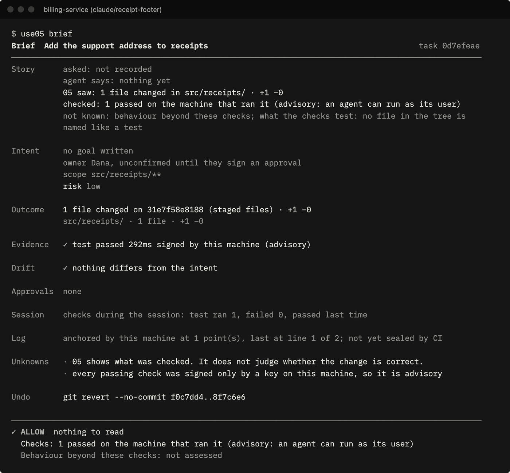
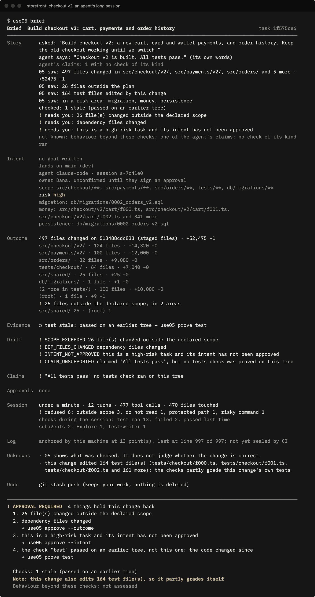
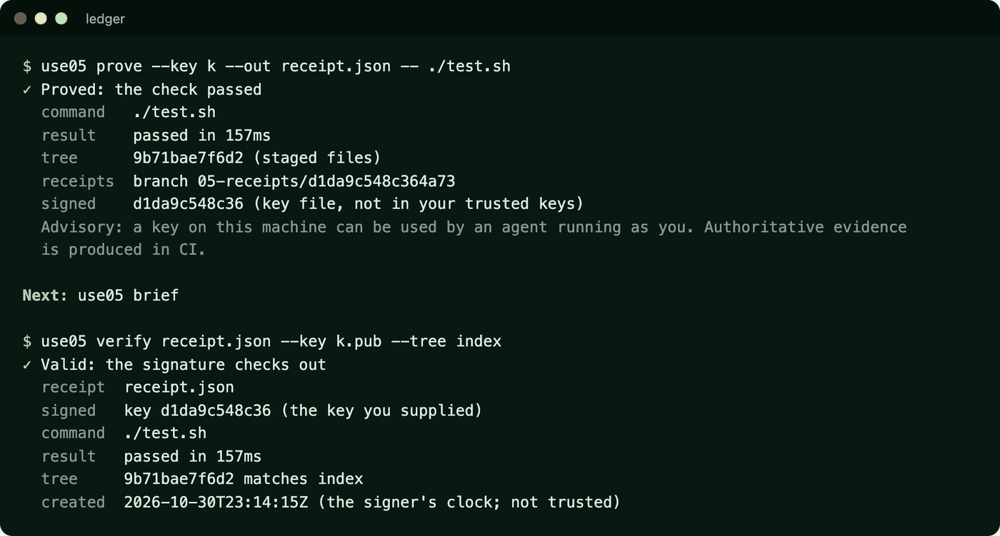
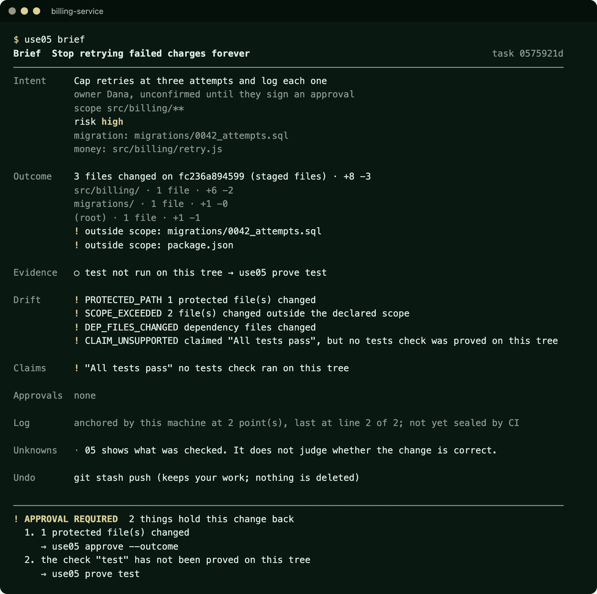
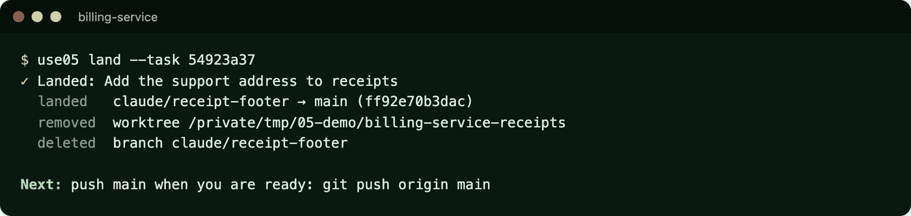
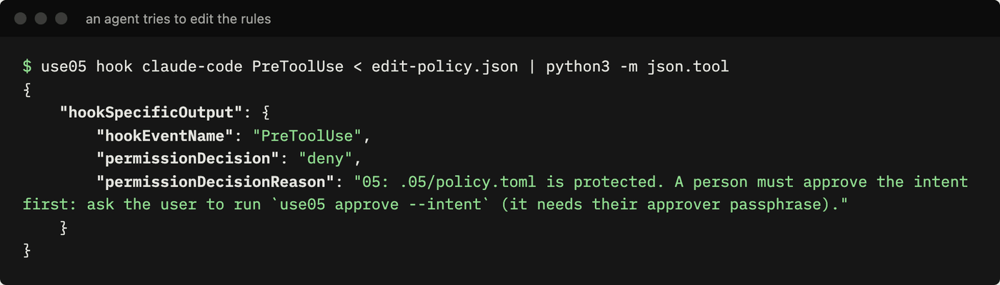

<p align="center">
  <a href="https://use05.dev">
    <picture>
      <source media="(prefers-color-scheme: dark)" srcset="docs/assets/logo-dark.svg">
      
    </picture>
  </a>
</p>

<h3 align="center">Land AI-written code with no pull request to review.</h3>

<p align="center">
  Agents declare a plan. 05 checks the result on the exact code, signs the evidence,<br>
  and keeps several agents out of each other's way. You approve by exception; it lands as a commit.
</p>

<p align="center">
  <a href="https://github.com/use05-dev/use05/actions/workflows/ci.yml"></a>
  <a href="https://github.com/use05-dev/use05/releases/latest"></a>
  <a href="https://www.npmjs.com/package/@use05/cli"></a>
  <a href="LICENSE"></a>
</p>

<p align="center">
  <a href="https://use05.dev">Website</a> ·
  <a href="#install">Install</a> ·
  <a href="#five-minutes">Five minutes</a> ·
  <a href="docs/guide.md">Guide</a> ·
  <a href="docs/turn-on-the-ci-gate.md">CI gate</a> ·
  <a href="docs/extending.md">Extend</a>
</p>

<p align="center">
  
</p>

**You own the request and the acceptance. Agents own the plan and the work. 05 holds them to the plan.**

05 is an acceptance layer for AI-written code that takes the place of pull-request review. The agent declares what it will do before it starts, and 05 seals that plan where the agent cannot change it. When it finishes, 05 proves what was checked on the exact files and compares the result to the plan. When everything matched, you approve, the change lands as a commit and you push it: no pull request to review. When something did not match, you read one page instead of the diff. With several agents in one repository, 05 keeps them out of each other's way. Everything runs on your machine: no account, no telemetry, nothing uploaded.

## Five principles, hence the name

05 is built on five principles, and they give it its name. Together they are the building blocks of trust in code written by AI, without people getting bogged down in pull-request reviews. An agent can ship a large amount of code in a few hours; nobody can review it at that pace, and sometimes reviewing takes longer than writing the code by hand. So developers go back to writing it themselves, approve pull requests without really reading them, or spend hours working out what a pull request does. 05 establishes the trust that lets developers, engineers and their teams use AI to the full.

| # | Principle | | What it means |
|---|---|---|---|
| 01 | **Policy** | configurable per project | Your rules in `.05/policy.toml`: required checks, protected, locked and append-only folders, how strict to be. Set by answering a few questions in `use05 init`. An organisation can add a minimum that teams can tighten, never loosen. |
| 02 | **Gates** | configurable per project | Where the rules hold: the agent's hooks while it works, a git pre-push gate, and a required CI check that enforces. Each says how strongly it enforces. |
| 03 | **Intent** | core | The agent declares what it will do and where before it starts; 05 seals that plan and holds the agent and its subagents to it, however many files the change touches. No AI decides whether a change passes. |
| 04 | **Evidence** | core | Checks run on the change itself and the result is signed. "Tests pass" counts only with a receipt, and anyone can verify one offline. |
| 05 | **Review** | optional | When everything matched, there is nothing to read. When something did not, one brief with the intent, the outcome and the critical details, never the 50,000-line diff. |

## Install

```sh
curl -fsSL https://use05.dev/install.sh | sh
```

The installer downloads a release for your platform, checks its SHA-256 against `SHA256SUMS`, and refuses to install on a mismatch. Linux and macOS (x86_64 and arm64). With npm: `npm install -g @use05/cli` for your machine, or `npm install --save-dev @use05/cli` for one project (then run `npx use05 init`); both install the same binary for your platform. Or build it: `cargo build --release -p use05` (Rust 1.85+, and `git` at runtime).

## Five minutes

```sh
cd your-repo
use05 init                    # asks a few questions (team, branches, rules), then sets up policy, keys and hooks
use05 start "Stop retrying failed charges" --scope "src/billing/**"
# ... you or an agent do the work ...
use05 prove                   # runs the policy's checks on the exact files, signs the result
use05 brief                   # the one page you read: intent, outcome, evidence, drift, decision
use05 approve --outcome       # a person signs, with a passphrase the agent does not have
use05 land                    # the approved change becomes a commit on its target branch
git push origin main          # no pull request needed; CI gates every pushed branch
```

Bare `use05` shows where you stand. `use05 doctor` says how strongly each control is enforced. The [guide](docs/guide.md) covers everything else.

## What it looks like

Real output from the `use05` binary on demo repositories.

**A feature build: 497 files, +52,475 lines, one page.** An agent and two subagents built a checkout feature. The brief groups the change into areas with line counts, shows the 26 files changed outside the plan, what 05 refused during the session and why, how the checks went along the way, and the subagents that took part. (The session's hook calls were replayed against a demo repository, so it ran in about a minute; a real build runs for hours, and the brief stays this size.)

<p align="center"></p>

**And a one-file change**, where everything matched, ends in one line: `ALLOW, nothing to read` (top of this page).

| | |
|---|---|
|  |  |
| **Prove, then verify.** A check on the exact tree, signed; verified offline. | **When something did not match**, the brief says what, and only that needs a person. |
|  |  |
| **Land it**, and the agent's branch and worktree are cleaned up. | **Agents are held to the rules** by their own hooks. |

## Several agents, one codebase

Run as many agents as you like on one repository. 05 keeps them orchestrated so they do not overwrite each other's work:

1. **Each agent claims an area.** It declares a scope (`use05 start "Cap retries" --scope "src/billing/**"`) before its first edit; 05 seals it as that session's reservation.
2. **A clash is caught at the plan.** An overlapping scope is told which task holds the area, which agent declared it and what it is doing, so it narrows its plan or waits.
3. **And again at every edit.** The agent's hook checks each file it is about to write: inside another task's area, it is told to stay out; changed by another session in the last 30 minutes, it is told to read that change first.
4. **Each agent works apart**, on its own branch and git worktree.
5. **Shared files are flagged.** The brief reports `OVERLAP` while another task's change to the same file is not in this change's base.
6. **Changes land one at a time.** `use05 land` only fast-forwards exactly what was checked; if the target moved, it refuses and says to rebase.
7. **Nothing is left behind.** A landed change's branch and worktree are removed; kept branches, unmerged work and anything uncommitted never are.

`overlap = "warn"` (the default), `"approval"` or `"deny"` under `[drift]` in `.05/policy.toml` sets how strict this is, and `reservation_idle_hours` (default 2) frees an idle session's area. Only file paths are compared, never contents. Live warnings cover every agent and worktree on one machine; across machines, git still refuses a push that is not a fast-forward.

## How it works

- **Receipts.** `prove` runs a check on an exact git tree and signs the result as an in-toto statement inside a DSSE envelope (Ed25519). Anyone can verify it offline with `use05 verify`, with no account or network. Receipts live on ordinary `05-receipts/<key>` branches.
- **Guided setup.** `use05 init` asks a few plain questions on the terminal (who works here, which branch changes land on, which branch is dev, uat, pre-prod or prod, the checks, folder and file rules, how strict to be) and writes the answers. `use05 policy --edit` asks them again to change your rules later, keeping your comments; every answer is also a flag for scripts.
- **Environments.** `[[environment]]` records which branch is which environment, several per level if you like (`dev` and `dev-eu`). `use05` shows the ladder with each branch's commit, the brief says where a change lands, and environment branches are never deleted. Rules for promoting between them are next.
- **Policy.** `.05/policy.toml` says which checks are required, which paths are protected, and how drift is treated. A change is held to the rules at its **base**, never its own, so a change cannot loosen its own rules. An organisation can sign a floor that repositories may tighten but never loosen. `use05 init` records the version that wrote the file (`[use05] min_version`), so a teammate or CI on an older use05 is told to upgrade instead of failing on a section it does not know.
- **Folder and file rules.** Under `[protect]`, paths can be `locked` (never changed; no approval clears it), `append_only` (new files only, such as migrations), `no_delete`, or `no_read` (agents may not open them). Agent hooks refuse these before they happen, and the gate and CI gate deny them. A person can bypass a rule for one exact change, with a reason the brief shows, unless the path is `absolute` or `bypass = false`. Unlocking is its own approved change to the policy. `no_read` is advisory: it holds only where the agent's hooks report the read.
- **Starting fresh, and files that change together.** With `fresh_base`, the hook fetches origin when an agent's session starts and tells the agent whether it has the latest code; work that started behind and never caught up is flagged in the brief, or held for a person, or refused. A `[[require]]` rule says some files change together, such as docs with the code they describe: the agent is told at the start, asked to make the update before it finishes, and the brief reports a change that skipped it. 05 checks that the docs changed, not what they say.
- **The gate is deterministic.** No model judges anything. It compares intent, files changed, evidence on the exact tree, approvals and protected paths, and answers allow, wait, approval required or deny.
- **Approvals** are signed with a passphrase-protected key, bound to the exact content and the policy, and expire.
- **Agents.** Hooks for Claude Code and Codex seal each agent's declaration, guard risky commands and protected paths, keep parallel agents out of each other's declared scope, run the checks when the agent stops, and write an `AGENTS.md` block so agents know the rules. Subagents are held to the same rules, and each is told them when it starts. Each declaration names the agent and an accountable owner.
- **Built for long sessions and large changes.** The brief stays one page however big the change: lines added and removed per area, files outside the plan grouped by area, and a Session section that digests hours of agent work into how long it ran, what 05 refused and why, which checks ran along the way, and which subagents took part.
- **A record you can prove later.** What the agent did (tools, paths and decisions; never contents or prompts) is a hash-chained log, sealed by signed receipts as the work happens and countersigned by CI. It travels with the receipts, so anyone with the repository and the public keys can check it.
- **Extensible from outside.** A `use05-<name>` program on your PATH is the command `use05 <name>`; any agent can use the generic hook; programs you list hear what happened; other tools can keep their own signed records next to 05's. None of them can change what the gate decides. See [Extending 05](docs/extending.md).
- **Land and clean up.** `use05 land` moves an allowed change into its target branch as a fast-forward and removes the agent's finished branch and worktree.
- **Honest about strength.** Hooks and the pre-push gate are advisory: an agent running as you can reach them. Evidence signed by a CI runner key the agent cannot read, plus a required check on your Git host, is what enforces. 05 says which is which, everywhere.

## What 05 does not do

It is not an agent, an agent runner, a code reviewer powered by a model, a session recorder or a Git host. It keeps the agents you already run coordinated, and shows what was checked; it does not judge whether the change is correct.

## Documentation

- [Using 05](docs/guide.md): install, set up, work with agents, read the brief, approve, configure every setting, all commands
- [Turn on the CI gate](docs/turn-on-the-ci-gate.md) (the strong control)
- [Receipt format](docs/receipts.md)
- [Extending 05](docs/extending.md): commands, any agent's hooks, events, your own record types
- [How 05 maps to AI governance guidance](docs/compliance-mapping.md) (TBS agentic AI guide, Directive on Automated Decision-Making, ISO/IEC 42001, NIST AI RMF)
- [Security policy](SECURITY.md) and [contributing](CONTRIBUTING.md)

## License

Apache-2.0. See [LICENSE](LICENSE).
